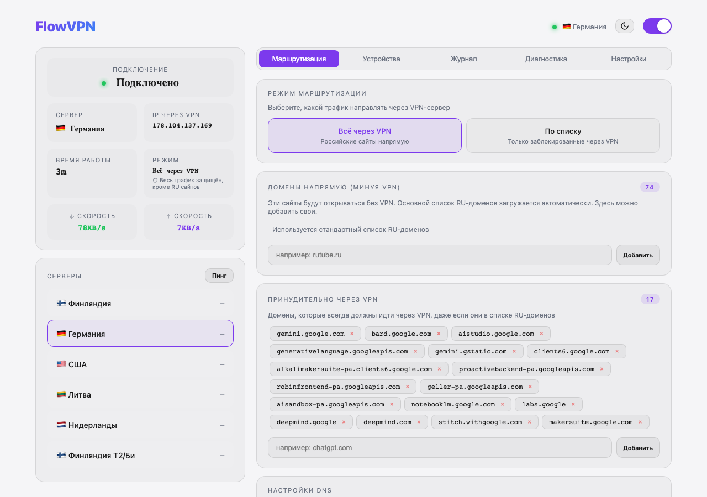

# EclipVPN

Лёгкий VPN-менеджер для роутеров на OpenWrt. Заворачивает весь трафик через VPN (VLESS+XHTTP+Reality), российские сайты идут напрямую.

[English](#english) | **Русский**



> **Имя**: продукт для пользователя называется **EclipVPN** (бренд, UI, URL `/eclipvpn/`). Внутренние пути и команды CLI остались `flowvpn` исторически — миграция backend ничего полезного не даёт, только риск что-то сломать.

## Возможности

- **Два режима маршрутизации**: «Всё через VPN кроме РФ» / «Только заблокированные»
- **VLESS + XHTTP + Reality** через xray-core 26.4.17+
- **sing-box tproxy** маршрутизация с geosite-ru / geoip-ru
- **Защита DNS**: перехват DNS, блокировка DoT и QUIC от подмены провайдером
- **Веб-интерфейс**: тёмная тема, glassmorphism, русский язык, mobile-friendly
- **Серверы**: импорт подписки (Remnawave / любая base64-vless), параллельный пинг с retry+ICMP fallback
- **Маршрутизация по устройствам**: VPN или Direct для каждого устройства в LAN
- **Скорость в реальном времени**: через Clash API WebSocket
- **Авто-переключение**: watchdog меняет сервер при сбое (тарифицируемые операторы исключаются)
- **Без утечек DNS**: при переключении nftables и dnsmasq остаются на месте — fail-closed, не direct
- **История сбоев**: таймаут проверок, авто-переключения, неудачные ручные смены — отдельный фильтр в журнале с бейджами «⚠ N» возле проблемных серверов
- **Учёт трафика**: per-chain (через VPN / напрямую), переживает рестарты sing-box, ручной сброс через UI
- **Журнал**: три источника (EclipVPN / sing-box / xray), фильтры с подсказками, экспорт в txt
- **Расписание**: cron включения/выключения по времени
- **Бэкап**: экспорт/импорт настроек как JSON
- **Диагностика**: автоматические проверки + healthcheck (xray, sing-box, nft, DNS, утечки IP)

## Требования

- Роутер с OpenWrt 23+ (тестировано на Routerich AX3000, aarch64)
- 256 MB+ RAM, 40 MB+ свободной flash
- Доступ в интернет для xray-core и списков доменов

## Быстрая установка

**Если репозиторий публичный:**
```bash
ssh root@router-ip
curl -sSL https://raw.githubusercontent.com/1eningrad/flowvpn/main/install.sh | sh
```

**Если приватный** — нужен fine-grained Personal Access Token (read-only `Contents` на этом репо):
```bash
ssh root@router-ip
REPO_TOKEN=ghp_xxxxx sh -c "$(curl -sSL \
  -H 'Authorization: Bearer $REPO_TOKEN' \
  https://raw.githubusercontent.com/1eningrad/flowvpn/main/install.sh)"
```

Установщик ставит зависимости, скачивает xray под архитектуру, кладёт скрипты и UI в правильные пути, создаёт redirect со старого `/flowvpn/` на `/eclipvpn/`.

## Ручная установка

```bash
# 1. Зависимости
opkg update
opkg install jq coreutils-base64 kmod-nft-tproxy sing-box unzip

# 2. xray 26.4.17+ (НЕ из opkg — там старый 25.1.30 с багами XHTTP)
# Скачать с https://github.com/XTLS/Xray-core/releases, положить в /usr/bin/xray, chmod +x

# 3. Скопировать файлы
# usr/bin/flowvpn           → /usr/bin/flowvpn
# usr/lib/flowvpn/*.sh      → /usr/lib/flowvpn/
# www/cgi-bin/flowvpn       → /www/cgi-bin/flowvpn
# www/flowvpn/index.html    → /www/eclipvpn/index.html  (новый путь)
# etc/init.d/flowvpn        → /etc/init.d/flowvpn

# 4. Права
chmod +x /usr/bin/flowvpn /www/cgi-bin/flowvpn /etc/init.d/flowvpn /usr/lib/flowvpn/*.sh

# 5. Настройка
flowvpn set-config subscription_url "https://your-subscription-url"
flowvpn update
flowvpn start

# 6. Автозапуск
/etc/init.d/flowvpn enable
```

## Веб-интерфейс

Откройте `http://router-ip/eclipvpn/`. Старая ссылка `/flowvpn/` отдаёт meta-refresh redirect.

### Вкладки

| Вкладка | Описание |
|---|---|
| **Маршрутизация** | Режим работы, списки доменов (direct/VPN), DNS-настройки |
| **Устройства** | LAN-клиенты, переключение VPN/Direct по MAC |
| **Журнал** | Соединения в реальном времени. Фильтры: Все · VPN · Direct · Ошибки · Сбои · DNS · EclipVPN. Под фильтрами видна короткая подсказка что значит каждый. |
| **Диагностика** | Быстрые метрики (статус, IP, сервер, время) + healthcheck (статус процессов, DNS, утечки, ресурсы, ошибки) |
| **Настройки** | Подписка, расписание, авто-обновление, бэкап |

## Команды CLI

```bash
flowvpn start | stop | restart | status
flowvpn set-server N                # Выбрать сервер по индексу
flowvpn set-mode all_vpn|blocklist  # Режим маршрутизации
flowvpn update                      # Обновить подписку и правила
flowvpn ping                        # Пинг всех серверов (TCP, retry, ICMP fallback)
flowvpn real-ping                   # Реальная задержка через VLESS+Reality (для отладки)
flowvpn diagnose                    # Быстрая диагностика
flowvpn healthcheck                 # Полная проверка (статус, DNS, утечки)
flowvpn add-domain DOMAIN vpn       # Принудительно через VPN
flowvpn add-domain DOMAIN direct    # Принудительно напрямую
flowvpn get-log 50 all              # Просмотр логов
flowvpn get-incidents               # История сбоев со статистикой по серверам
flowvpn clear-incidents             # Очистить историю сбоев
flowvpn reset-traffic               # Обнулить счётчики «Через VPN» / «Напрямую»
flowvpn backup                      # Экспорт настроек
```

## Архитектура

```
Клиент → dnsmasq(:53) → sing-box DNS(:5354) → dns-proxy(VPN) / dns-direct
       → nftables tproxy → sing-box(:2154) → xray SOCKS(:1080) → VPN-сервер (VLESS+Reality)
                                            → direct (RU-сайты)
```

### Как работает маршрутизация

**Режим «Всё через VPN кроме РФ»:**
- Все DNS-запросы идут через VPN (защита от подмены)
- DNS для RU-доменов — напрямую (быстрее)
- geosite-ru + geoip-ru — тысячи российских доменов и IP → напрямую
- Всё остальное → через VPN-сервер
- DoT (порт 853) и QUIC (UDP 443) блокируются → приложения откатываются на обычный DNS / TCP

**Режим «По списку»:**
- Только домены из Shadowrocket-списка → через VPN
- Всё остальное → напрямую

## Важные нюансы

- **xray ≥ 26.4.17** — версия из opkg (25.1.30) ломает XHTTP+Reality
- **mark 0x8000** — обязателен для обхода правил fw4
- **geosite-ru включает google.com** — Gemini / AI Studio добавляйте в «Принудительно через VPN»
- **QUIC (UDP 443) блокируется** в режиме «Всё через VPN» — приложения откатываются на TCP
- **Время на роутере должно быть синхронизировано** — иначе Reality handshake падает (NTP при первом запуске)

## Обновление существующей установки

```bash
# Скопировать обновлённые файлы (тот же набор) → restart
flowvpn restart
# Hard reload UI в браузере: Cmd+Shift+R / Ctrl+Shift+R
```

При первом запуске создаётся `/etc/flowvpn/clash_secret` (32 hex, chmod 600) — токен Clash API. UI получает его через `/status`, ничего вручную не настраивается.

## Решение проблем

1. **Сайт не открывается** → Журнал → фильтр «DNS» (резолвится ли) и «Direct/VPN» (куда идёт)
2. **Приложение пишет «нет сети»** → авиарежим вкл/выкл, либо `flowvpn restart`
3. **«Не поддерживается в вашей стране»** → добавьте домен в «Принудительно через VPN»
4. **Сервер мерцает** → бейдж «⚠ N» в списке серверов + история в Журнале → фильтр «Сбои»
5. **Сломался WAN** → `ssh root@router` → `flowvpn stop` → проверить интернет на роутере отдельно

## Документация

- [docs/flowvpn_manual.pdf](docs/flowvpn_manual.pdf) — подробный мануал (PDF, RU)
- [docs/ROADMAP.md](docs/ROADMAP.md) — план развития

Сборка PDF: `cd docs && tectonic flowvpn_manual.tex` ([tectonic](https://tectonic-typesetting.github.io/))

## Ресурсы

- **RAM**: ~112 MB (xray 64 + sing-box 46)
- **Flash**: ~33 MB (xray 32.5 + скрипты 112 KB)
- **CPU**: ~0% (Reality на aarch64 очень лёгкий)

---

<a name="english"></a>
## English

Lightweight VPN manager for OpenWrt routers. Routes traffic through VLESS+XHTTP+Reality, Russian sites bypass the tunnel.

### Quick install

Public repo:
```bash
curl -sSL https://raw.githubusercontent.com/1eningrad/flowvpn/main/install.sh | sh
```

Private repo (fine-grained PAT, read-only `Contents`):
```bash
REPO_TOKEN=ghp_xxxxx sh -c "$(curl -sSL \
  -H 'Authorization: Bearer $REPO_TOKEN' \
  https://raw.githubusercontent.com/1eningrad/flowvpn/main/install.sh)"
```

See the Russian section above for full documentation.

## License

MIT
